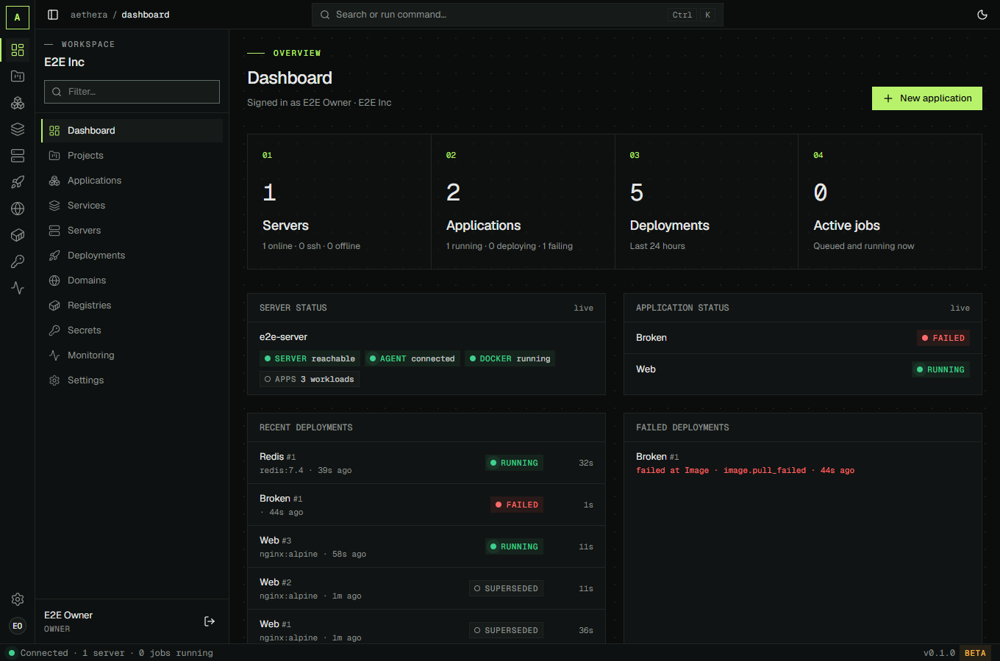
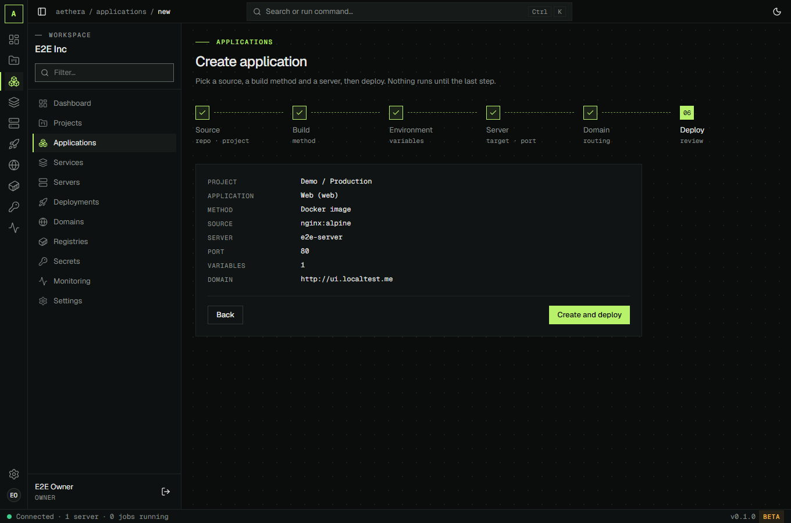
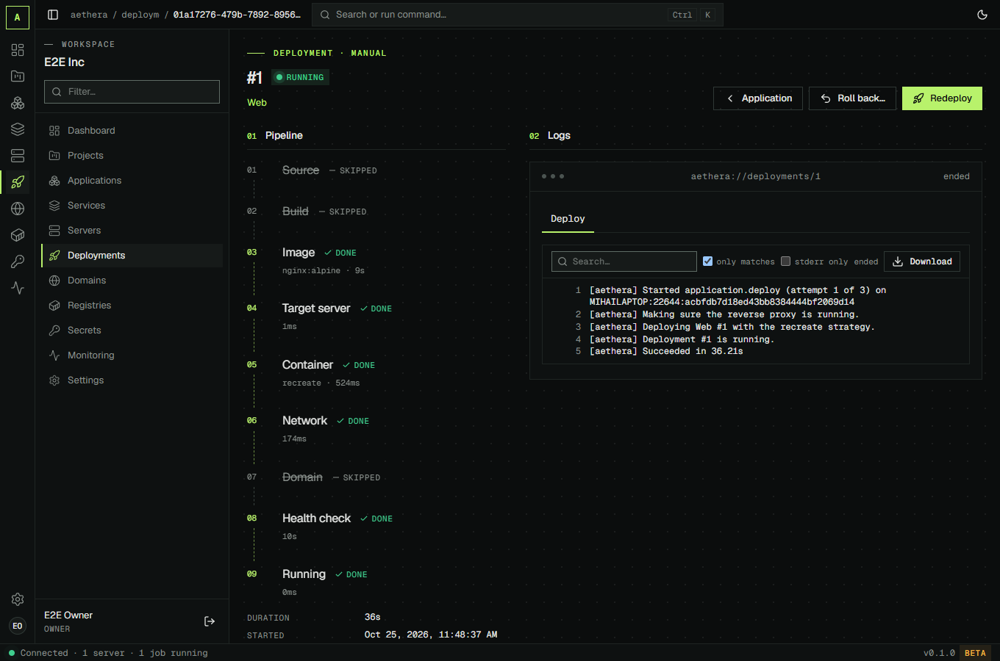
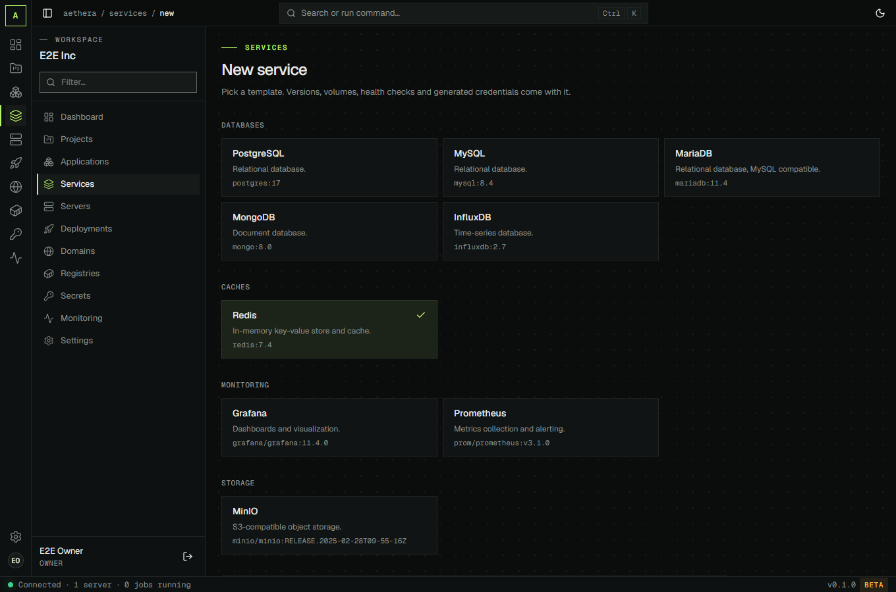
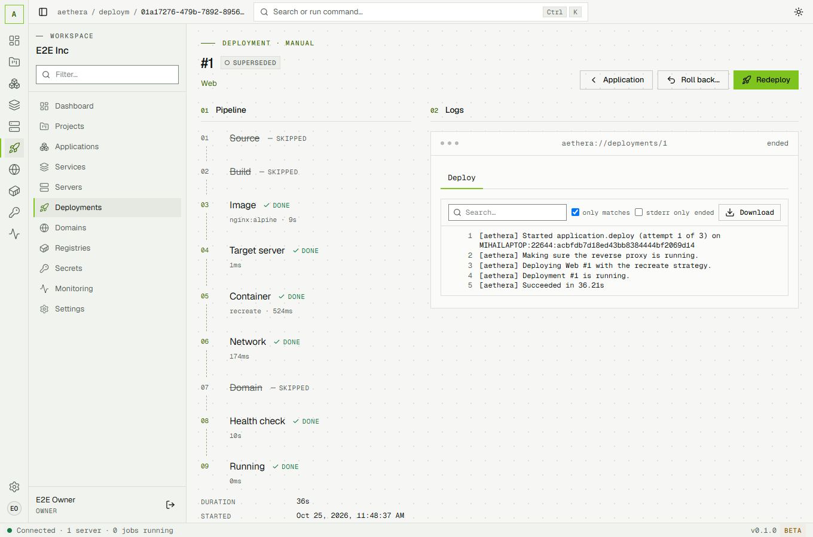

<p align="center">
  
</p>

<h1 align="center">Aethera</h1>

<p align="center">
  <b>Self-hosted infrastructure. Simple deployments. Full control.</b><br>
  An open-source deployment platform for your own servers: a Coolify alternative with first-class multi-server support.
</p>

<p align="center">
  <a href="https://github.com/MihaiM21/Aethera-Forge/actions/workflows/ci.yml"></a>
  <a href="https://github.com/MihaiM21/Aethera-Forge/releases/latest"></a>
  <a href="LICENSE"></a>
  
  <a href="CONTRIBUTING.md"></a>
  <a href="https://github.com/MihaiM21/Aethera-Forge/stargazers"></a>
</p>

<p align="center">
  
  
  
  
  
</p>

<p align="center">
  <a href="#install">Install</a> ·
  <a href="#features">Features</a> ·
  <a href="#screenshots">Screenshots</a> ·
  <a href="#how-it-works">How it works</a> ·
  <a href="docs/install.md">Docs</a> ·
  <a href="docs/roadmap.md">Roadmap</a> ·
  <a href="CONTRIBUTING.md">Contribute</a>
</p>

<picture>
  <source media="(prefers-color-scheme: light)" srcset="docs/assets/screenshots/dashboard-light.png">
  
</picture>

> [!NOTE]
> **Beta.** Aethera is feature-complete for real workloads and is tested on production infrastructure, but the **API and the configuration may still change between 0.x releases**. Back up before every update (`aethera backup`, plus the backups of your services to S3). 1.0 follows about a month of real use: a real restore, two servers, no data-loss bug. See the [roadmap](docs/roadmap.md).

## Why Aethera

- **Your servers, your data.** One control plane you host, one small static agent per server. No SaaS in the middle, no telemetry.
- **Built for more than one server.** Roles (master, build, storage, worker), automatic placement, builds on one server and the result on another, and a private WireGuard mesh between them.
- **Safe by construction.** The agent runs only typed, allowlisted commands, never arbitrary shell. Servers dial in over mutual TLS and need only outbound access. Secrets are encrypted at rest, masked in the UI and redacted from logs. See the [trust model](docs/architecture/0006-trust-model.md).
- **API first.** Everything the UI does goes through a documented API, so it can be scripted.
- **Coming from Coolify?** There is a [migration guide](docs/migration-from-coolify.md).

## Install

On a Linux server, as root:

```bash
curl -fsSL https://github.com/MihaiM21/aethera-forge/releases/latest/download/install.sh | sudo bash -s -- \
  --admin-email you@example.com --host aethera.example.com --acme-email you@example.com
```

It installs Docker if needed, generates the secrets, starts the control plane with PostgreSQL and Redis, creates the owner and enrolls an agent for the machine. More servers join with one command from the UI. Updates, backups and housekeeping are built in (Settings > System, or `aethera update`).

`--acme-email` is the Let's Encrypt account and is needed for HTTPS. To try Aethera on Windows or macOS with Docker Desktop, run `pwsh deploy/install.ps1` from a checkout and open http://localhost:8080 (for trying out only; run real workloads on a Linux server).

Full guide, options and troubleshooting: [`docs/install.md`](docs/install.md).

## Features

| | |
|---|---|
| **Deploy anything** | Git repositories (GitHub, GitLab), Dockerfiles, Nixpacks, static sites, plain Docker images and Docker Compose projects. Rollback to any earlier deployment. |
| **One-click services** | PostgreSQL, MySQL, MariaDB, MongoDB, InfluxDB, Redis, Grafana, Prometheus and MinIO from templates, with volumes, health checks and generated credentials. Adding one is adding a YAML file. |
| **Domains and HTTPS** | Traefik proxy, automatic Let's Encrypt, Cloudflare DNS-01 and wildcards, automatic `sslip.io` domains for a first deploy, www redirects, basic auth. |
| **Multi-server** | Server roles, automatic placement by free memory, build on one server and run on another through a registry, CPU and memory limits, priorities and a capacity view. |
| **Private network** | A WireGuard mesh managed by the agent (or Tailscale). A database bound to the mesh is reachable from apps on other servers and never from the internet. |
| **Pull request previews** | A preview of every GitHub or GitLab pull request at its own host, removed when the PR closes. |
| **Backups** | PostgreSQL, MySQL, MongoDB, Redis and volumes to S3-compatible storage (AWS, R2, MinIO), encrypted, scheduled, with retention and restore. |
| **Operations** | Live logs, scheduled tasks, email and webhook alerts, an audit log, secrets and registries, and a self-updater with rollback. |
| **A UI you will like** | Dark and light themes, a command palette (`Ctrl+K`), keyboard chords and a layout that works on a phone. |

Detailed notes: [multi-server](docs/multi-server.md), [networking](docs/networking.md), [previews](docs/previews.md), [backups](docs/backups.md).

## Screenshots

<table>
  <tr>
    <td width="50%"><br><sub><b>Create an application</b> in six steps: source, build, environment, server, domain, deploy.</sub></td>
    <td width="50%"><br><sub><b>Every deployment</b> is a visible pipeline with live logs and a one-click rollback.</sub></td>
  </tr>
  <tr>
    <td width="50%"><br><sub><b>Services from templates:</b> databases, caches, monitoring and storage.</sub></td>
    <td width="50%"><br><sub><b>Dark and light</b> themes, both first-class.</sub></td>
  </tr>
</table>

## How it works

```
  Browser ──HTTPS──▶  Control plane  ◀──mTLS (agent dials out)──  Agent ─▶ Docker + Traefik   (server 1)
                      .NET API + UI                              Agent ─▶ Docker + Traefik   (server 2)
                      PostgreSQL, Redis                          Agent ─▶ Docker + Traefik   (server N)
                                                                         └──── WireGuard mesh ────┘
```

| Component | Tech | Path |
|---|---|---|
| Control plane (API, jobs, deploy orchestration) | .NET 10 / ASP.NET Core, EF Core, PostgreSQL, Redis | [`src/control-plane`](src/control-plane) |
| Server agent | Go, one static binary (linux amd64 and arm64) | [`src/agent`](src/agent) |
| Web UI | Next.js (App Router, static export), Tailwind v4, shadcn/ui | [`src/web`](src/web) |
| Agent protocol | Protobuf / gRPC | [`proto`](proto) |

The UI is a static export served by the API, so an install is one stack with no separate frontend. The design decisions are written down as ADRs in [`docs/architecture/`](docs/architecture/README.md).

## Quick dev start

Prerequisites: .NET 10 SDK, Go 1.24, Node 22 with pnpm 10, Docker (for PostgreSQL and Redis), `buf` (only when changing `proto/`).

```bash
docker compose -f deploy/docker-compose.dev.yml up -d     # PostgreSQL 17, Redis 7

cd src/control-plane && dotnet run --project src/Aethera.Api   # http://localhost:5033/health
cd src/agent && make all                                       # vet, test, build
cd src/web && pnpm install && pnpm dev
```

More in [`docs/development.md`](docs/development.md) (running the whole stack from a checkout) and [`CONTRIBUTING.md`](CONTRIBUTING.md) (tests, end-to-end checks, rules).

## Trust and quality

- **Tested for real.** CI runs about 470 database tests against real PostgreSQL and Redis, the agent's tests, a protocol freshness check and the web lint, tests and build. End-to-end scripts run the real stack: a real agent with Docker-in-Docker and a browser run of the whole UI (`deploy/agent-e2e.sh`), and the installer and updater on a throw-away host (`deploy/install-e2e.sh`).
- **Releases built in the open.** Releases are built by [a workflow](.github/workflows/release.yml) in this repository and publish the container images to GHCR and the installer as release assets.
- **Open decisions.** Architecture decisions, known limits and the plan are public: [`docs/architecture/`](docs/architecture/README.md), [`docs/plan.md`](docs/plan.md).
- **Security.** Please report vulnerabilities privately, see [`SECURITY.md`](SECURITY.md).

## Roadmap

Next: a CLI, config-as-code (`aethera.yaml`), environment promotion, blue/green and canary deploys, OIDC and GitHub login, an integrated registry, more notification channels. Status of every work package: [`docs/roadmap.md`](docs/roadmap.md). What changed in each release: [`CHANGELOG.md`](CHANGELOG.md).

## Contributing

Issues, ideas and pull requests are welcome. Start with [`CONTRIBUTING.md`](CONTRIBUTING.md); read the ADR of the area you touch before changing it. Everyone taking part is expected to follow the [Code of Conduct](CODE_OF_CONDUCT.md).

## License

Apache-2.0, see [`LICENSE`](LICENSE). The Aethera name and logo (in [`docs/assets/brand`](docs/assets/brand)) identify this project; please do not use them to suggest your fork is the official one.
