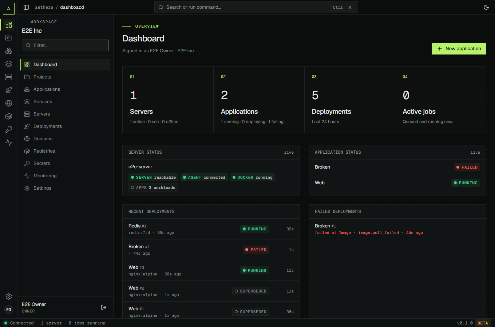

# Aethera

> **Self-hosted infrastructure. Simple deployments. Full control.**

Aethera is an open-source platform for deploying and running applications, databases and containers on your own servers: an alternative to Coolify, built for and tested on real production infrastructure. Push to Git, and Aethera builds, deploys, routes, backs up and watches your apps.



> **v0.1 is a beta.** It runs real workloads, but the API and the configuration may still change between 0.x releases. **Back up before every update** (`aethera backup`, and your services' backups to an S3-compatible destination). 1.0 follows about a month of production use.

## What it does

**Deploy**
- Applications from **Git** (GitHub, GitLab or any host; public, token or deploy key), built with a **Dockerfile**, **Docker Compose** (read from the repository, `build:` included), Nixpacks or as a static site, or straight from a **Docker image**.
- **Auto-deploy** on push (signed webhooks), a nine-step pipeline with live build and deploy logs, **rollback** to any kept deployment, low-downtime or recreate strategies, health checks.
- **Services from templates**: PostgreSQL, MySQL, MariaDB, MongoDB, Redis, InfluxDB, Grafana, Prometheus, MinIO, with generated credentials stored as encrypted secrets and reachable from your apps by name.

**Route**
- Domains with automatic HTTPS through Aethera's own Traefik: Let's Encrypt HTTP-01, or **Cloudflare DNS-01** for wildcards and certificates before the DNS switch.
- A domain per compose service, www/apex redirects, path-prefix stripping, basic auth, and a DNS check that understands Cloudflare's proxy.

**Protect**
- **Backups** to Cloudflare R2, Backblaze B2, AWS S3 or MinIO: database dumps and volume archives, encrypted before they leave the server, on a cron schedule with retention, and restorable into the same service or a new one ([guide](docs/backups.md)).
- **Email notifications** (SMTP or Resend) and signed webhooks for failed deployments, backups and tasks, unreachable servers, full disks, crashing containers, expiring certificates and updates; alerts open, remind and resolve on their own.
- **Scheduled tasks**: cron commands run inside your app's container, with history and logs.

**Operate**
- Servers connect through a small Go agent that dials out over mutual TLS (no inbound ports, no SSH keys on the control plane); an SSH fallback for machines without the agent. One server is enough: the machine Aethera runs on is connected automatically.
- Live server metrics, Docker inventory, logs, a dashboard and an audit log; roles (owner, admin, developer, viewer) and scoped API tokens.
- One-click **updates** that back up the database first and roll back on their own if the new version does not start; weekly cleanup of old images.

## Install

On a fresh Linux server with systemd (Ubuntu or Debian, for example; amd64 or arm64):

```bash
curl -fsSL https://github.com/MihaiM21/aethera-forge/releases/latest/download/install.sh | sudo bash -s -- \
  --admin-email you@example.com --domain aethera.example.com --acme-email you@example.com
```

It installs Docker if needed, generates the secrets, starts the control plane with PostgreSQL and Redis, creates your account and connects the machine as your first server. Open `http://<server-ip>:8080` right away. With a DNS record for `--domain` pointing at the server, the UI is also served on `https://aethera.example.com` (`--acme-email` is your Let's Encrypt account; without it there is no HTTPS).

**Release candidates** are pre-releases, so `latest` does not find them. Fetch the script from the release and pin the version:

```bash
curl -fsSL https://github.com/MihaiM21/aethera-forge/releases/download/v0.1.0-rc.1/install.sh | sudo bash -s -- \
  --version 0.1.0-rc.1 --admin-email you@example.com --domain aethera.example.com --acme-email you@example.com
```

More servers join with one command from **Servers > Add server**. Keep a copy of `/opt/aethera/.env`: its master key decrypts your secrets and your backups. Everything else, including Docker Desktop for a local try-out, is in the [install guide](docs/install.md).

**Coming from Coolify?** Follow the [migration guide](docs/migration-from-coolify.md): it moves a stack side by side with no downtime you did not choose.

## How it works

```
Browser ──► Aethera control plane (.NET 10)          ◄── Git webhooks
            REST API · jobs · deploy engine · UI
            PostgreSQL (state) · Redis (live logs)
                     │  gRPC over mutual TLS (the agent dials out)
                     ▼
            Aethera agent (Go) on every server
            Docker · builds · Compose · Traefik · backups · metrics
```

The control plane decides what should run where; the agent on each server executes a fixed list of typed commands (there is no remote shell) and streams logs, events and metrics back. Details and the decisions behind them: [architecture overview](docs/architecture/README.md).

| Component | Tech | Path |
|---|---|---|
| Control plane (API, jobs, deploy engine) | .NET 10, ASP.NET Core, EF Core, PostgreSQL, Redis | `src/control-plane` |
| Agent | Go, a static binary for linux/amd64 and arm64 | `src/agent` |
| Web UI | Next.js (static export), Tailwind v4, shadcn/ui | `src/web` |
| Agent protocol | Protobuf / gRPC (buf) | `proto` |

## Documentation

| | |
|---|---|
| [Install guide](docs/install.md) | Installation options, more servers, HTTPS, updates, the `aethera` command, troubleshooting |
| [Backups](docs/backups.md) | Cloudflare R2 setup, schedules, restoring a service or Aethera itself |
| [Migrating from Coolify](docs/migration-from-coolify.md) | Moving a production stack step by step |
| [Architecture](docs/architecture/README.md) | How the parts fit and the decision records (ADRs) |
| [Roadmap](docs/roadmap.md) | What is done and what comes next |
| [Changelog](CHANGELOG.md) | What changed in each release |

## Roadmap

- **0.1 (beta, now)**: everything above, on one or more independent servers.
- **0.2**: multi-server roles and placement (build on one server, run on another, resource quotas), a private WireGuard network between servers, preview deployments for pull requests.
- **0.3 and later**: a CLI, configuration as code, environment promotion, blue/green and canary deployments, OIDC sign-in, an integrated registry, more notification channels.

## Development

You need the .NET 10 SDK, Go 1.24, Node 22 with pnpm 10 and Docker.

```bash
docker compose -f deploy/docker-compose.dev.yml up -d              # PostgreSQL 17 and Redis 7
cd src/control-plane && dotnet build && dotnet test                # API on dotnet run --project src/Aethera.Api
cd src/agent && make all                                           # vet, test, build (make cross for linux binaries)
cd src/web && pnpm install && pnpm dev                             # the UI
```

The database tests need `AETHERA_TEST_DB` (and optionally `AETHERA_TEST_REDIS`), and the end-to-end checks are `deploy/install-e2e.sh` and `E2E_PHASES=ui deploy/agent-e2e.sh`. See [CONTRIBUTING.md](CONTRIBUTING.md) for the full setup, the rules contributions follow and how releases are made.

## License

Apache-2.0, see [LICENSE](LICENSE).
