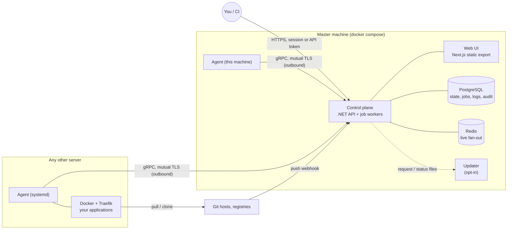

# Architecture

Aethera is a **control plane** that orchestrates **agents** on the servers you own. This page is the map; the decisions and their reasons are in the ADRs it links to.

## Components

| Component | Tech | Path | What it owns |
|---|---|---|---|
| Control plane | .NET 10, ASP.NET Core, EF Core | `src/control-plane` | The REST API (`/api/v1`, OpenAPI), authentication and roles, the durable job queue, the deployment engine, the agent gateway (internal CA, mutual-TLS gRPC), update checks and maintenance |
| Agent | Go, static binary (amd64, arm64) | `src/agent` | Typed, allowlisted Docker, image, volume, network, Compose, build, proxy and log commands on one server; metrics and events; self-update with rollback |
| Web UI | Next.js (static export), Tailwind v4, shadcn/ui | `src/web` | Everything a person does; no logic the API lacks. Served by the API from the export |
| Protocol | Protobuf over gRPC | `proto/` | The agent protocol, generated into Go (committed) and C# (build time) |
| Packaging | Dockerfiles, Compose, shell | `deploy/` | Images, the production stack, `install.sh`, `install-agent.sh`, the updater and the `aethera` command, end-to-end checks |

Dependency direction in the control plane: `Api -> Infrastructure, Engine -> Domain`; `Domain` depends on nothing. `Engine` is pure (it turns a configuration snapshot into a deployment plan and renders Traefik configuration); `Infrastructure` talks to PostgreSQL, Redis, agents and SSH.

## How the main flows work

**A deployment.** The API stores a *deployment* with a frozen configuration snapshot and enqueues a job. A worker runs the nine steps (source, build, image, target server, container, network, domain, health check, running) by sending typed commands to the agent of the target server, writes progress to the deployment's step rows and its log to `log_chunks`. The UI polls steps and logs; SignalR streams job logs too. A failure marks the step it happened in; a rollback is a deployment of an earlier image. See [ADR 0004](0004-jobs-and-deployments.md) and [ADR 0007](0007-build-and-deploy.md).

**An agent connects outward.** A server needs no inbound port. On install the agent enrolls once with a single-use token and the pinned CA fingerprint, receives a client certificate, and then keeps one bidirectional gRPC stream open to the control plane; commands go down it, acknowledgements, results, logs, metrics and events come back. When the stream is down the server shows as "agent unavailable" and jobs wait or fail with a clear code; an SSH fallback exists for the commands that can use it. See [ADR 0002](0002-agent-communication.md).

**Secrets.** Encrypted with a master key (AES-256-GCM, versioned); the key is not in the database. Values reach a container only as environment at deploy time; the API never returns one except through the audited reveal endpoint. See [ADR 0006](0006-trust-model.md).

**Routing.** Each server runs one Traefik managed by Aethera (`aethera-traefik`, ports 80 and 443) on the `aethera-proxy` network; applications carry labels generated from their domains; certificates come from Let's Encrypt. Workloads of an environment share a private network so applications reach services by name.

**Upgrades and housekeeping.** [ADR 0009](0009-packaging-and-self-ops.md): the release workflow, the installer, update notification, the updater with its rollback, migration safety, backups and retention.

## Decision records

| ADR | Topic |
|---|---|
| [0001](0001-record-architecture-decisions.md) | How decisions are recorded |
| [0002](0002-agent-communication.md) | The agent protocol, enrollment, transport, self-update |
| [0003](0003-api-conventions.md) | REST conventions, errors, paging, roles and scopes, OpenAPI |
| [0004](0004-jobs-and-deployments.md) | The job queue, locks, logs, the deployment model |
| [0005](0005-web-routing.md) | Serving the static export, detail-page routing |
| [0006](0006-trust-model.md) | Who may configure what, secret handling |
| [0007](0007-build-and-deploy.md) | Build engines, the deploy engine, Traefik, Git integration |
| [0008](0008-product-ui.md) | Product UI, services as workloads, the YAML template format |
| [0009](0009-packaging-and-self-ops.md) | Packaging, installation, updates, backups, retention |
| [0010](0010-backups-notifications-tasks.md) | Backups of workloads, email notifications and alerts, scheduled tasks, compose from Git, DNS-01 and domain options |
| [0011](0011-automatic-domains-and-first-try-deploys.md) | Automatic domains (wildcard / sslip.io), the dashboard domain in Settings, ports from EXPOSE, liveness checks, safe recreate, compose data that survives deploys |
| [0012](0012-multi-server-mesh-previews.md) | Server roles and placement, build on one server and run on another through a registry, build quota, priorities, the WireGuard / Tailscale mesh and private ports, pull request previews |

## Guides

[Install](../install.md) · [Migrating from Coolify](../migration-from-coolify.md) · [Contributing](../../CONTRIBUTING.md) · [Roadmap](../roadmap.md) · [Plan](../plan.md)
